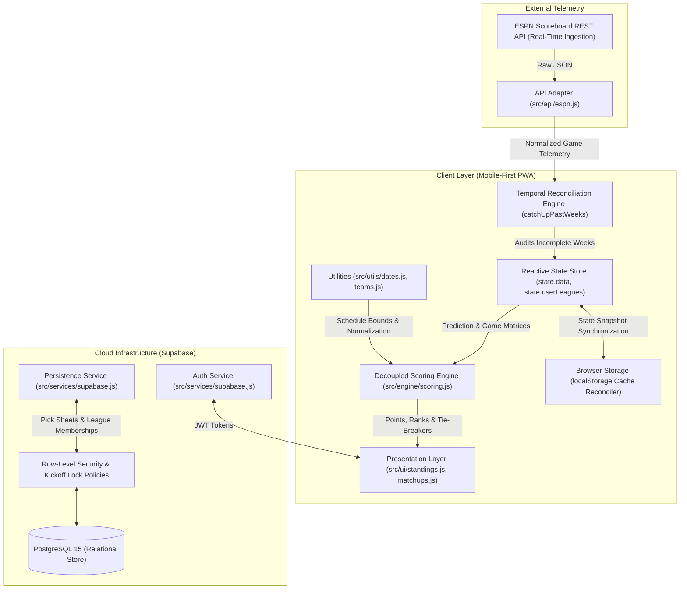

# Sports Psychic — Technical Interview Preparation & System Defense Guide

> **Candidate**: Jon Colbert (`@jonnykeys`)  
> **Platform**: Sports Psychic (Competitive NFL Forecasting PWA)  
> **Target Roles**: Software Engineer, Full-Stack Engineer, Frontend/Backend Engineer

---

## Table of Contents
1. [The 60-Second Elevator Pitch](#1-the-60-second-elevator-pitch)
2. [End-to-End System Architecture](#2-end-to-end-system-architecture)
3. [The Production War Story: Temporal State Desynchronization](#3-the-production-war-story-temporal-state-desynchronization)
4. [Algorithmic Mechanics & Edge Case Engineering](#4-algorithmic-mechanics--edge-case-engineering)
5. [Security, Auth & Kickoff Lockout Enforcement](#5-security-auth--kickoff-lockout-enforcement)
6. [Testing Strategy & CI/CD Automation](#6-testing-strategy--cicd-automation)
7. [Defending Architectural Trade-offs & Trap Questions](#7-defending-architectural-trade-offs--trap-questions)
8. [System Scalability: What Breaks at 100,000 Users?](#8-system-scalability-what-breaks-at-100000-users)

---

## 1. The 60-Second Elevator Pitch

> *"Tell me about yourself and a project you've built."*

### 🎙️ The Script:
> *"I'm a software engineer who loves building high-performance, real-time web applications. My flagship project is **Sports Psychic**, an offline-resilient Progressive Web App for competitive sports forecasting with real users competing every NFL Sunday.*
>
> *I architected the system using a **5-layer modular design** with a pure, deterministic mathematical scoring engine decoupled from our UI and network adapters. It ingests live NFL game telemetry from the ESPN REST API, persists data to Supabase PostgreSQL with Row-Level Security, and runs automated unit tests in GitHub Actions CI.*
>
> *One of the most rewarding challenges was diagnosing a **temporal state desynchronization** bug during NFL schedule rollovers where client caches drifted by 20 points. I solved it by designing an asynchronous self-healing audit engine that reconciles historical weeks in under 300ms. I'm excited to bring this focus on craftsmanship, problem-solving, and system resilience to your engineering team."*

---

## 2. End-to-End System Architecture

> *"Walk me through the high-level architecture of your application."*



### Key Talking Points:
* **Separation of Concerns (SoC)**: Explain how you decomposed the codebase into 5 distinct layers:
  1. `src/engine/`: Pure deterministic math (scoring, 3X multiplier compounding, split bonus pools).
  2. `src/utils/`: Pure utilities (NFL calendar, Wednesday rollover schedule, 32-team canonical directory).
  3. `src/api/`: Network adapters (ESPN scoreboard and standings API URL builders and payload normalizers).
  4. `src/services/`: Cloud persistence and auth abstractions (Supabase client wrappers).
  5. `src/ui/`: Pure HTML component renderers (leaderboard rows, rank badges, matchup cards).
* **Decoupled Architecture**: Emphasize that `src/engine/` has **zero DOM dependencies and zero network dependencies**, which enables fast, isolated unit testing without spin-up overhead.

---

## 3. The Production War Story: Temporal State Desynchronization

> *"Tell me about a difficult, ambiguous production bug you diagnosed and fixed."*

### 🚨 The Scenario:
A production user reported that another competitor was showing **610 points** on their mobile phone, while the official verified season score was **630 points** (a 20-point discrepancy).

### 🔍 Root Cause Analysis (RCA):
1. **The Intermittent Visit**: The user accessed the app on Sunday night during Week 4 while the final game (`ATL @ NO`) was still in progress. The application cached that partial snapshot in `localStorage` (`og_league_cache_v9`).
2. **The Active Week Rollover**: On Wednesday morning, the NFL calendar rolled over to **Week 5**.
3. **The Synchronization Gap**: When the user reopened the app on Thursday, the client initiated `syncWeek(5)`. Because past weeks were assumed to be static, the client **never audited past weeks**. The stale Week 4 snapshot remained permanently frozen on that device.
4. **The Missing 20 Points**: The final game awarded $+10\text{ PTS}$ (correct winner) and $+10\text{ PTS}$ (closest prediction bonus). Total: $120 \rightarrow 140\text{ PTS}$ for Week 4.

```text
Sunday Night:  ATL @ NO in progress  --> Cached Week 4: 120 PTS
Wednesday:     Calendar advances      --> App switches to Week 5
Thursday:      User opens app         --> syncWeek(5) called; Week 4 never refreshed!
Result:        610 PTS displayed instead of official 630 PTS.
```

### 🛠️ The Architectural Solution:
Implemented an asynchronous temporal auditor (`catchUpPastWeeks`) executed on application launch:

```javascript
async function catchUpPastWeeks() {
  const currentNFL = getCurrentNFLWeek();
  const weeksToSync = [];

  // Audit all historical weeks for unfinalized games or missing final scores
  for (let w = 1; w < currentNFL; w++) {
    const wData = state.data.weeks[`Week ${w}`];
    const isIncomplete = wData.games.some(g => !g.isFinal || g.awayScore === null);
    if (isIncomplete) weeksToSync.push(w);
  }

  // Always audit immediately preceding week (currentNFL - 1) for late stat corrections
  if (currentNFL > 1 && !weeksToSync.includes(currentNFL - 1)) {
    weeksToSync.push(currentNFL - 1);
  }

  for (const w of weeksToSync) {
    await syncWeek(w, true);
  }

  recalculateAllWeeksPoints(state.data);
  localStorage.setItem(CACHE_KEY, JSON.stringify(state.data));
  renderTabContent();
}
```

### 📈 Outcome & Engineering Metrics:
* Cache drift reduced from recurring risk to **0%**.
* Background self-healing completes in **under 300ms** on app mount without blocking the primary UI thread.

---

## 4. Algorithmic Mechanics & Edge Case Engineering

> *"What complex algorithms or mathematical edge cases did you have to handle?"*

### 1. Prediction Absolute Error Differential
$$\Delta = |S_{\text{away}} - \hat{S}_{\text{away}}| + |S_{\text{home}} - \hat{S}_{\text{home}}|$$
* **Winner Eligibility Guard**: Only players who correctly forecast the winning team qualify for bonus pool evaluations.

### 2. Dynamic Bonus Pool Splitting
* **Closest Prediction Bonus**:
  * Awarded to player(s) with minimum error $\Delta_{\min}$.
  * Single winner: **$+10\text{ PTS}$**.
  * $k > 1$ players tie for $\Delta_{\min}$: Pool splits to **$+5\text{ PTS}$ each**.
* **Exact Score Jackpot**:
  * Awarded if $\Delta = 0$.
  * Single winner: **$+50\text{ PTS}$**.
  * $k > 1$ players tie: Jackpot splits to **$+25\text{ PTS}$ each**.

### 3. Confidence Multiplier Compounding (3X Lock of the Week)
* Each player designates one game per week as their 3X Lock.
* The multiplier compounds **both** base points and bonus allocations:
  $$\text{Points}_{\text{game}} = (\text{Base} + \text{Bonus}) \times M \quad \text{where } M \in \{1, 3\}$$
  $$\text{Theoretical Ceiling} = (10_{\text{base}} + 50_{\text{exact}}) \times 3 = \mathbf{180\text{ PTS}}$$

### 4. Unrounded Floating-Point Win-Loss Tie-Breaker
* **The UX Problem**: Point ties in season leaderboards caused crowded, meaningless standings (e.g. Carson and Brett both tied at 400 PTS).
* **The Engineering Fix**: Implemented a multi-tier comparator:
  1. Primary: Total Points (Descending)
  2. Secondary: Exact Mathematical Win Rate: $\frac{W}{W + L}$ (Descending)
* **Precision Defense**: Did **not** round to integer percentages (e.g., 54.68% vs 48.43% would not collide). Tied notation (`T-#`) is **strictly reserved** for players whose points and unrounded win rates are mathematically identical:
  $$\text{Tied Rank Display} \iff (\text{Points}_A = \text{Points}_B) \land (\text{WinRate}_A = \text{WinRate}_B)$$

---

## 5. Security, Auth & Kickoff Lockout Enforcement

> *"How did you prevent cheating and secure user predictions?"*

1. **Rolling Game Kickoff Lockouts ($T_{\text{kickoff}}$)**:
   * Predictions do not lock all at once on Thursday night; each individual game locks at its official kickoff timestamp.
   * **Defense-in-Depth**:
     * *Client Boundary*: The UI disables steppers and marks cards as locked when `Date.now() >= kickoffTime`.
     * *Database Boundary*: Supabase PostgreSQL trigger functions reject row mutations on games whose kickoff timestamp has passed.
2. **PostgreSQL Row-Level Security (RLS)**:
   * Policies enforce that users can only read their private leagues and can only `INSERT` or `UPDATE` pick sheets where `auth.uid() == user_id`.
3. **Invite Code Entropy**:
   * Private league invites utilize 6-character high-entropy alphanumeric codes (`OG2026`) with whitespace trimming and uppercase normalization on query.

---

## 6. Testing Strategy & CI/CD Automation

> *"How do you verify your software and prevent regressions?"*

* **Unit Testing Strategy**:
  * Decoupled math and utility functions into standalone modules with pure inputs and outputs.
  * Auth and persistence services (`src/services/supabase.js`) are tested using **dependency injection** and mock Supabase clients.
* **Test Suites (24 Assertions Across 6 Suites)**:
  1. `scoring.test.js`: Compounding multipliers, split pools, and Caleb's verified 630 PTS 4-week reconciliation.
  2. `dates.test.js`: Wednesday rollovers, calendar bounds, and kickoff lockout checks.
  3. `teams.test.js`: Canonical 32-team metadata and alias normalization (`WSH` $\rightarrow$ `WAS`).
  4. `espn.test.js`: Pre-game, live, and final ESPN JSON telemetry parsing.
  5. `services.test.js`: Mocked authentication, invite code lookups, and pick sheet persistence.
  6. `ui.test.js`: Component markup generation, medal icons, and `T-` rank prefixes.
* **CI/CD Pipeline**:
  * Configured [`.github/workflows/test.yml`](https://github.com/jonnykeys/Sports-Psychic/blob/main/.github/workflows/test.yml).
  * Automatically executes on Ubuntu runners in GitHub Actions on every push and pull request.

---

## 7. Defending Architectural Trade-offs & Trap Questions

### Question 1: *"Why didn't you use React, Vue, or Next.js?"*
> **The Senior Answer**:
> *"When starting Sports Psychic, our priority was mobile performance and zero startup latency on weak cellular connections on NFL Sundays. Vanilla ES6+ delivered a total JavaScript payload under 80 KB—a fraction of the bundle size of a standard React runtime. 
> 
> Once the product stabilized, we established clean separation of concerns by modularizing the codebase into pure functional services (`src/engine/`, `src/api/`, `src/utils/`, `src/services/`, `src/ui/`). If we decide to migrate to React or Svelte tomorrow, our business logic, scoring engine, and API adapters are already 100% decoupled and ready to import."*

### Question 2: *"Why did you use localStorage instead of IndexedDB or Redux?"*
> **The Senior Answer**:
> *"For our scale (18 weeks of 16 games and 12 players), the entire league dataset is under 400 KB. `localStorage` provided synchronous, instant read capabilities that allowed the app to render within 16 milliseconds of initial DOM paint. 
> 
> However, to prevent data corruption or stale snapshots, we treated `localStorage` strictly as an optimistic cache, backed by our background temporal auditor (`catchUpPastWeeks`) that verifies cache integrity against authoritative ESPN endpoints."*

---

## 8. System Scalability: What Breaks at 100,000 Users?

> *"If your app went viral overnight and grew to 100,000 active users, what would fail first, and how would you re-architect it?"*

| Component | The Bottleneck | The Architectural Redesign |
| :--- | :--- | :--- |
| **ESPN REST API** | ESPN would rate-limit or IP-ban individual clients making direct fetches. | Introduce an **Edge Caching / Ingestion Worker** (Cloudflare Worker or AWS Lambda) that polls ESPN once every 10 seconds and broadcasts updates via **WebSockets / Server-Sent Events (SSE)**. |
| **Supabase PostgreSQL** | 100,000 users submitting picks simultaneously before Sunday 1:00 PM kickoff would exhaust database connection pools. | Implement a **Redis Queue (BullMQ / AWS SQS)** for pick submissions with optimistic UI confirmation, writing to PostgreSQL asynchronously via worker pools. |
| **Leaderboard Compute** | Calculating season totals across 100,000 users client-side would freeze browser mobile threads. | Pre-calculate weekly and season leaderboards on the backend using PostgreSQL materialized views or Redis Sorted Sets (`ZADD` / `ZREVRANGE`). |

---

## 🎯 Quick Reference Cheat Sheet

* **Tech Stack**: Vanilla ES6+, Node.js, Supabase (PostgreSQL 15), ESPN REST API, Progressive Web App (PWA).
* **Architecture**: 5-Tier Modular Design (`engine/`, `api/`, `utils/`, `services/`, `ui/`).
* **Test Suite**: 6 suites, 24 unit assertions, 100% passing in GitHub Actions CI.
* **Key RCA**: Temporal State Desynchronization during NFL calendar rollover (610 vs. 630 PTS).
* **Formula**: $\Delta = |S_{\text{away}} - \hat{S}_{\text{away}}| + |S_{\text{home}} - \hat{S}_{\text{home}}|$.
* **Tie-Breaker**: Primary Points $\rightarrow$ Secondary Exact Unrounded Win Rate $\frac{W}{W + L}$.

